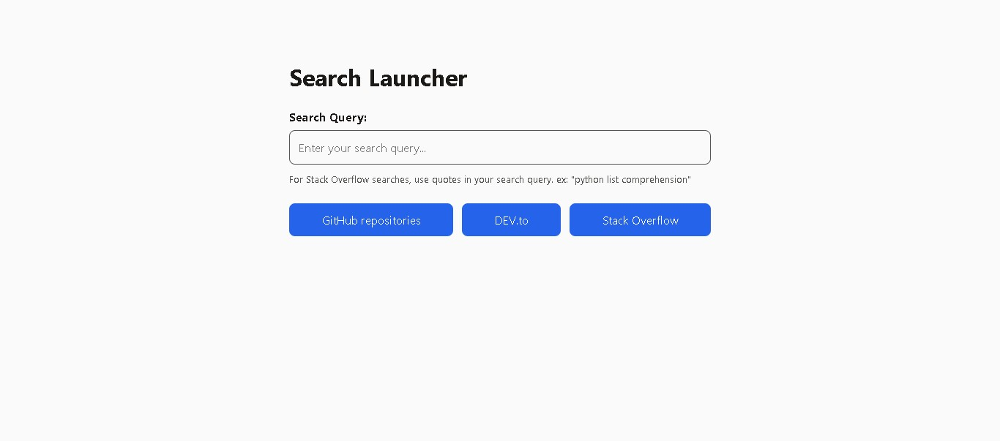

# Search Launcher

One search box that opens the same search on GitHub, DEV.to, or Stack Overflow, depending on which button you press. Results open in a new tab, so the launcher stays where it is.

It is a single static HTML file with no JavaScript, no build step, and no network requests until a button is clicked. The zero-JavaScript rule was a constraint I set for myself to learn what a plain HTML form can do on its own. It is not a claim that this is the better way to build it.

This is a small practice project, not a product. V1 is finished and meets the six acceptance checks I wrote before building it.

## Screenshot

<!-- ADD: one screenshot (light mode is fine; a second in dark mode is a plus). Save as screenshot.jpg in the repo root. -->



## Links

- **Live demo:** https://tarek-elzoghby.github.io/search-launcher/
- **Source:** [github.com/Tarek-Elzoghby/search-launcher](https://github.com/Tarek-Elzoghby/search-launcher)

## How it works

One native `<form method="get">` holds a single field named `q`. Each button overrides where the form goes with `formaction`:

```html
<button formaction="https://github.com/search" name="type" value="repositories">
  GitHub repositories
</button>
<button formaction="https://dev.to/search">DEV.to</button>
<button formaction="https://stackoverflow.com/search">Stack Overflow</button>
```

The browser reads the field, URL-encodes it, and builds the address. Nothing in the page stores, copies, or rewrites the text. `target="_blank"` on the form opens every result in a new tab. Pressing Enter in the field activates the first button, so GitHub is the default destination.

## Known limitations

These are documented walls of V1, not bugs I missed.

- **One shared field name.** Every destination has to accept its search text under `q`. GitHub, DEV.to, and Stack Overflow all do. A site that expects `query` or `s` would not work, because plain HTML cannot send one field under a different name per button. A fourth site like that would be the real reason to add JavaScript.
- **Stack Overflow needs quotes.** In my testing (October 2026, repeated across tabs and browsers), a single unquoted word that matches a tag redirects to the tag page, and an unquoted multi-word search triggered a human-verification check every time. Quoted searches stayed on `/search` with no check. This is observed behaviour, not documented behaviour, so it could change. The page carries a hint line about it.
- **Destinations can interrupt.** A sign-in prompt or a verification page is the destination's decision, and nothing in the form controls it. I treated this as a limitation to record, not something to engineer around.
- **GitHub code search is not offered.** In my first attempt it required a signed-in session, so V1 targets repository search only.
- **The three sites are a starting set.** I have not checked that they match anyone's real research habits.

## Process & decisions

The full build log is kept separately. These are the decisions that shaped the result.

**The name.** The working name was "Zero-JavaScript Query Builder". Nothing in the project builds a query, since the browser serializes the form itself, and the name described how it is made rather than what it does. It became `search-launcher`.

**Getting `type=repositories` to GitHub only.** The first spec put `?type=repositories` on the action URL. Rather than a hidden `type` field, which would send `type=repositories` to every destination, the GitHub button carries its own `name` and `value`, so only that button sends it. I never tested whether a GET form replaces a query string already on its action URL. The design never relied on it, so I dropped the question.

**The Stack Overflow path mistake.** My first attempt pointed the button at `/questions/tagged/`, expecting the search text to land after `tagged/`. A GET form can only put fields in the query string, never in the path, and `/questions/tagged/css` is a tag listing, not a search. I went back to `/search`, which takes `q` like the other two.

**`target` on the form, not `formtarget` on each button.** The spec said `formtarget="_blank"` per button. Stating it once on the form covers all three, so I kept that as a deliberate deviation.

**Colours as variables, and a palette that changed on screen.** Colours are CSS custom properties on `:root`, redefined in a `prefers-color-scheme: dark` block, so every rule switches automatically. Hard-coding hex values would have meant writing every rule twice. The palette started with three colours and grew to five because white text on the light-blue dark-mode accent was hard to read. I added `--on-accent` for text on buttons. A palette on paper was not trustworthy until I had seen it rendered.

**Layout choices that were rejected.** Flex on `main` to fill the empty space under the content: rejected, because `main` is only as tall as its content and `space-between` would pull together things that belong together. Content is top-aligned with extra top padding instead, since the field is autofocused and on a phone the keyboard covers the lower half of the screen. Other rejected options: a web font (a network request before submission, fails offline), per-button brand colours (the labels already tell them apart), and a separate CSS file (it would make a standalone page two files).

**Accessibility.** The hint is wired to the input with `aria-describedby`, so screen readers announce it on focus. I removed an early `aria-live="polite"` because the hint never changes, so there is nothing to announce. Both buttons and the field keep a visible focus ring, with an offset on the buttons because an outline touching an accent-filled button would be invisible.

**Small mistakes I caught in review.** A stray `margin: 0.5rem` on the input shifted it out of line with the heading and label, and the same mistake appeared later on the label. The overflow was hidden inside `main`'s side padding, so my narrow-window scrollbar test passed anyway. A dark-mode selector of `:root:not([data-theme="light"])` was always true, because nothing sets `data-theme` without JavaScript, so I replaced it with plain `:root`.

## Built with

- HTML, one file (about 120 lines with the CSS inline)
- CSS: custom properties, flexbox, `prefers-color-scheme`, `color-scheme: light dark`
- System font stack, no web fonts
- No JavaScript, no build step, no dependencies

**Checked by hand:** both colour modes (DevTools rendering emulation), a narrow window with no horizontal scrollbar, keyboard focus on every control, each button on the finished page, the Network tab after a reload (no requests), and opening the file from `file://`. Lighthouse scored 100 in every category on the finished page.

## What I learned

- A GET form can only place fields after the `?`, never in the path.
- A button can carry its own `name` and `value`, so only the clicked button sends them.
- A label stacks above an input only because the input is full width. Labels are inline by default.
- A check that passes does not mean the code is right: two stray margins were hiding inside padding.
- Behaviour I observe on someone else's site is a correlation until proven otherwise, so I repeated the Stack Overflow test across tabs and browsers before documenting it.

## AI collaboration

<!-- CONFIRM BEFORE PUBLISHING: this section is drafted from the build log's own wording. Correct anything that does not match what actually happened, then delete this comment. -->

I built this with an AI collaborator. It proposed the V1 structure, challenged the original project name, listed the three known limitations before any code was written, and reviewed the code for mistakes such as the unneeded `aria-live`, the stray margins, and the dead `data-theme` selector. The decisions and the testing were mine: I clicked through every destination, checked both colour modes on screen, and ran the Lighthouse and Network-tab checks myself.

## Author

**Tarek Elzoghby | طارق الزغبي**: [GitHub](https://github.com/Tarek-Elzoghby)
